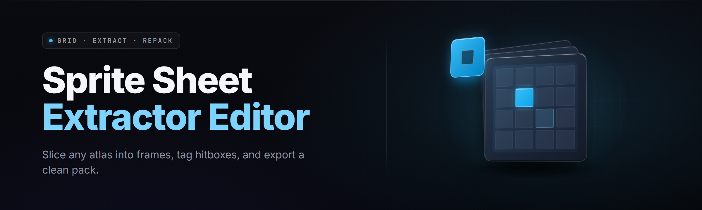

  
  
  

  

  
  
  

---

I built **sprite-sheet-extractor-editor** after two months on my main smashing my head against the same wall every pixel artist hits: a shipping build drops a 4096×4096 PNG packed with 1,400 frames, the artist who made it moved on, and there's no XML, no JSON, no `.plist` — just a grid of little guys staring back at you. This is the "just gimme the tiles" tool.

---

## 📖 Overview

Sprite sheet extractor and editor takes a packed sheet and gives you back a real, editable asset pipeline — cutting, tagging, previewing animation, and re-exporting to whatever your engine wants.

| Category | Details |
|---|---|
| What it does | Auto-detects frame grid, slices, names, tags, animates, re-exports |
| Who it's for | Pixel artists, indie devs, modders, ROM-hacking folks, game-jam speedrunners |
| Input formats | PNG, BMP, GIF, WEBP, TGA |
| Output formats | Individual PNGs, trimmed PNGs + JSON atlas, GIF/APNG previews, SPINE-ready JSON |
| Platform | Windows 10/11 x64, single portable `.exe`, no installer, no runtime |
| Batch mode | Headless CLI inside the same `.exe` — point it at a folder, walk away |
| Engine presets | Unity, Godot 4, GameMaker, Phaser, Bevy, Love2D, Aseprite XML, TexturePacker-compatible |
| Latest build | v2.6.1 — mosaic-family repack, see Known Issues |

The tool went from "my own tile chopper" to a full editor because every session ended with *"okay but now I want to rename the frames, now I want to fix the stride, now I want a GIF of the run cycle."* So it's all in there. The pipeline starts at a spreadsheet-shaped mystery texture and ends at a tagged, engine-ready folder — without a screenshot, a five-tab Photoshop ritual, or a `.psd` from someone's forgotten cloud drive.

---

## 🎮 What is sprite-sheet-extractor-editor — glossary

| Term | Explanation |
|---|---|
| Sheet | One image containing many sprite frames laid out on a grid or packed atlas |
| Cell / Frame | A single sprite region inside the sheet |
| Stride | The measured pixel distance between consecutive cell origins |
| Atlas | A sheet plus a text/data file describing each frame's rect, pivot, tags |
| Non-uniform frame | A sprite whose transparent bounding box varies (hair, weapon, dust puff) |
| Pivot | The anchor point a frame rotates/positions around (feet, center, top-left) |
| Repack | Re-laying extracted frames into a fresh sheet with tighter padding |

**Why people actually keep it open in a corner:**

- Drag a sheet in and the auto-grid guesser usually nails the layout in one click.
- Manual grid correction takes ten seconds — keyboard arrow striding, X/Y offsets, per-cell nudge.
- Detects non-uniform frames and can trim or keep full cells, your call.
- Exports an atlas + JSON that drops into Unity/Godot/Phaser without hand-editing.
- Paint/erase/edit tools so you fix a single bad pixel without round-tripping to Photoshop.
- Batch over an entire `/frames` folder — hundreds of sheets, one job, walk away.

---

## 🗂️ Module set — grouped by pipeline stage

### 🔍 Detection and inspection (5)

- **Grid Auto-Scan** — Measures opacity bounds, infers stride from edge deltas, snaps to the most likely N×M grid; notes guess confidence.
- **Stride Probe** — Paints vertical/horizontal ruler overlays while you arrow-key stride; live overlay redraws on every keystroke.
- **Bounding Box Pass** — Per-cell alpha-channel bounds so you see exactly where each sprite's content lives before cutting.
- **Duplicate Frame Hasher** — Hashes each cell, flags identical frames (a jam-build's "same 4 frames stretched" trick, caught instantly).
- **Sheet Inspector** — Dumps dimensions, color-depth, DPI, palette, and a per-row/column entropy graph so you know what you're looking at.

### ✂️ Extraction (6)

- **Grid Slicer** — Slice to N×M cells, single asset, non-square, or per-frame rect list.
- **Non-uniform Extractor** — Greedy color/alpha connected-region splitter for sheets where frames are scattered, not gridded.
- **Confidence Preview** — Shows every frame it found, ringed in a color determined by detection confidence; low-confidence frames highlighted yellow.
- **Keep / Trim Toggle** — Per-frame toggle between full-cell export and tight-alpha-bbox export; bulk-set via row.
- **Mask Channels** — Use any channel (or a sidecar mask PNG) as the alpha reference so baked-spill backgrounds don't bleed.
- **Split Sheet Parts** — Chop oversized sheets into tileable pages automatically, with overlap for safety.

### 🏷️ Editing and tagging (7)

- **Frame Renamer** — Rename with token pattern (`{group}_{index:03}`), batching patterns across selections.
- **Tag Editor** — Assign many tags per frame (`idle`, `walk`, `hit`, `attack_a`), drag-multi-select tags, filter frames by tag.
- **Pivot Setter** — Click-to-set pivot or coordinate entry; store per-frame or globally; visible crosshair overlay.
- **Frame Reorderer** — Drag frames to any order; drives the atlas and GIF/APNG play order.
- **Onion Skin** — Ghost the previous and next frame with adjustable opacity; perfect for refining run-cycle sync.
- **Transparency Fill** — Flood-remove a chosen key color to alpha, with edge-antialias pass.
- **Quick Pixel Brush** — Fix one eyelash, one stray pixel, one bad pixel — without leaving the tool.

### 🎞️ Preview and animation (5)

- **Looper Panel** — Preview any tagged loop (`walk_cycle`, `attack_combo`) at real-time or frame-step; scrub, scrub, scrub.
- **Ping-Pong / Reverse** — Flip playback direction, auto-pingpong for breathing/idle cycles.
- **Frame Timing** — Per-frame duration; export timing into the atlas JSON for engines that honor it.
- **Sprite Sheet Player** — Flipbook the whole sheet with the grid locked — verify slicing against the source's own motion.
- **A/B Sheet Overlay** — Overlay reference sheet vs current extraction; catches "one pixel too far" drift side-by-side.

### 📦 Export and integration (6)

- **Atlas JSON Writer** — TexturePacker v3-compatible JSON + N individual PNGs (Unity/Phaser/Bevy ready).
- **Godot 4 TileSet Builder** — `.tres` TileSet with source grid pre-set, tile collision boxes stubbed, atlas texture imported correctly.
- **Unity Sprite Atas Export** — Emits `SpriteAtlas` asset + individually sliced sprite metadatas.
- **Aseprite XML In/Out** — Round-trip Aseprite's JSON; keep source metadata if it exists.
- **GIF / APNG Stitcher** — Assemble frames back into a playable preview — great for PRs and itch pages.
- **CLI Batch Queue** — Drag a folder, apply a preset, run headless over 600 sheets while you get coffee.

### 🧰 Platform and quality (4)

- **Preset System** — Named presets per game/engine/style; ship one preset to every artist on your team.
- **Undo Stack (Intent-Level)** — Undo is per-operation, not per-pixel; fifty moves back still coherent.
- **Pixel-Accurate Color Handling** — No resampling, no color-management surprises; palette stays exactly as it came in.
- **Texture Memory Estimator** — Pre-flight estimate of VRAM on target hardware based on final atlas dimensions + channel count.

Total in this build: **33 modules**.

  

---

## 🔎 Why the existing workflow is a whole pain — The Problem

- Every `frames.png` for the past decade comes from an older pipeline where the XML has been lost, renamed, or was *never* committed.
- Photoshop slicing breaks under non-uniform frames; you end up with SIXTY windows and a bad case of ALT+TAB.
- Frameworks' official importers insist on one specific JSON dialect and *cheerfully ignore* the one you already have.
- Non-uniform sheets (dust, hair, weapon extensions) get trimmed inconsistently, wrecking every `pivot_y` you ever wrote.
- Free online slicers upload your art to a mystery server and PNG-re-encode everything — the palette comes back wrong.
- Repacking a sheet for a new engine means re-tagging animation cycles by hand. For the same thirty frames. Again.
- Batch jobs (600 sheets, a backend migration) mean someone writes an awk script and cries quietly on Thursday.

---

## 🧪 The Solution — Problem | Solution

| Problem | Solution |
|---|---|
| Lost importer metadata | Grid auto-scan + reusable Preset, no sidecar required |
| Non-uniform trimming wrecking pivots | Per-frame Keep/Trim toggle with pivot-on-trim re-anchor |
| Framework JSON dialect wars | Seven engine exporters from one atlas, no editing needed |
| Free online slicers upload your art | Everything runs offline in a local `.exe` — art never leaves the box |
| Repacking = manual retagging | Tag once, reuse tags across export targets |
| Big batch jobs | Drag a folder, CLI in the same `.exe`, walk away |
| Color/palette blowups | Pixel-exact passes; no resampling, no CM reinterp on export |

---

## ⚙️ Quick Start — five steps

1. 🧾 **Grab the current build** — hit 

  

 below and pull the portable Windows `.exe` zip.
2. 📂 **Extract anywhere** — no installer, no admin, no runtime. Unzipped is a fresh folder; run the `.exe` from there.
3. 🖼️ **Drag a sheet onto the window** — the auto-grid guesser draws its best guess; fix stride with arrow keys if needed.
4. 🏷️ **Tag the loops you actually need** — `idle`, `walk`, `hit`, `attack`. Not every frame has to be tagged.
5. 📦 **Export with a target preset** — Unity, Godot 4, GameMaker, Phaser, Aseprite XML, whatever your project is. Ship it.

---

## 📚 Usage guidelines — Allowed | Not allowed

| Allowed | Not allowed |
|---|---|
| Your own sheets, your own assets, any game you legally own | Ripping commercial sheets you don't have rights to and redistributing them |
| Modding, ROM-hacking, educational study | Using the tool to break DRM on protected assets |
| Batch processing your team's own folders | Uploading extracted frames to a cache service as "yours" |
| Sharing your own extracted frames with perm permission | Republishing a commercial sheet as your own pack |
| Inspecting sprites for research, reverse-design, learning | Packing someone else's work into a "free assets" dump without attribution |

---

## 🔧 Installation — three steps

1. **Download the release zip from the project landing page** — it's a single `.exe`, plus a `README` and `LICENSE`. No Qt/Redist/MSVC installer comes with it.
2. **Extract to a folder you'll remember** (e.g. `C:\Tools\SSXE\`). Windows SmartScreen may show the "unknown publisher" first-run dialog — allow it, pin the folder.
3. **Run the `.exe`** from that folder. First-run creates a config folder in `%APPDATA%\sprite-sheet-extractor-editor\` for presets, recent files, and window state.

---

## 💾 System Requirements

| Component | Minimum | Recommended |
|---|---|---|
| OS | Windows 10 x64 (1909+) | Windows 11 x64 22H2+ |
| CPU | 2-core 2.0 GHz (any modern x86-64) | 6-core+ for batch / non-uniform |
| RAM | 2 GB free | 8 GB free for sheets over 8K |
| GPU | Any Direct3D 11-capable | DX11 with 2 GB+ VRAM for overlay previews |
| Disk | 120 MB free | 2 GB free for extracted batches |
| Display | 1280×720 | 1920×1080 or higher |
| Input | Mouse | Drawing tablet / stylus helps for Quick Pixel Brush |

---

## 🖥️ Compatibility / platform support

| Target | Support | Notes |
|---|---|---|
| Windows 10/11 x64 | ✅ Primary target | Native `.exe`, no runtime dependency |
| Wine on Linux | ⚠️ Works | Older wine versions break alpha overlay; use 9.x+ |
| macOS | ❌ Not currently | Not building for ARM until cross-compile is clean |
| Import PNG | ✅ Supported | 8-bit and 24/32-bit RGBA |
| Import BMP/TGA | ✅ Supported | Legacy sheets, palette-aware |
| Import GIF/APNG | ✅ Supported | Animation frames land in play order |
| Import WEBP | ✅ Supported | Lossless + alpha; lossy with caution |
| Export PNG/APNG/GIF | ✅ Supported | APNG is best for PR previews |
| Export atlas JSON | ✅ Supported | TexturePacker v3 dialect |
| Export Godot `.tres` | ✅ Supported | Godot 4.x |
| Export Unity atlas | ✅ Supported | Atlas utility format |
| Export Aseprite | ✅ Supported | JSON dialect |

---

## 💡 Tips for best results

- Take the auto-grid guess but always glance at the frame boundary ruler — an off-by-one row can turn a two-hour cut into a six-hour reseat.
- Set pivots to feet or axis-of-rotation before exporting; several engines ignore `pivot` on individual frames if the atlas doesn't carry it.
- Tag at exactly one granularity (`leg = every leg frame`) not mixed (`leg = the whole walk cycle, but also this one frame`).
- Keep `PNG-POT tuned` ON unless you need tiny increments; over-enlarge or letterboxing quietly destroys pixel-perfect fidelity.
- For non-uniform sheets, use a sidecar mask instead of the auto alpha pass if your sprite has semi-transparent sprites (dust/sparkles/etc.).
- Preset wins over patience: save a preset the day you finish your first sheet from a new game, reuse it for the other 480 in the pipeline.
- Batch jobs love the CSV input mode — one row per sheet, columns map to per-sheet options, one command runs them all.

---

## 📊 Module status

| Module | Status | Description |
|---|---|---|
| Grid Auto-Scan | ✅ Working | Infers stride from opacity bounds and most-common edge deltas |
| Stride Probe | ✅ Working | Live ruler overlay while arrow-key striding |
| Bounding Box Pass | ✅ Working | Per-cell alpha bounds for keep/trim export decisions |
| Duplicate Frame Hasher | ✅ Working | Flags identical cells (the "same 4 frames" trick, caught) |
| Sheet Inspector | ✅ Working | Dimensions, palette, entropy graph per row/column |
| Grid Slicer | ✅ Working | N×M, non-square, rect lists, single asset |
| Non-uniform Extractor | ✅ Working | Connected-region splitter for scattered frames |
| Confidence Preview | ✅ Working | Ringed colors per-frame for detection confidence |
| Keep / Trim Toggle | ✅ Working | Per-frame and per-row keep-or-trim, pivot re-anchor option |
| Mask Channels | ✅ Working | Sidecar mask or any input channel drives alpha reference |
| Split Sheet Parts | ✅ Working | Automatic pagination with overlap guard for oversize sheets |
| Frame Renamer | ✅ Working | Token patterns `{group}_{index:03}` etc. |
| Tag Editor | ✅ Working | Multi-tag per frame, filter view, drag-multi-assign |
| Pivot Setter | ✅ Working | Click-to-pivot or coordinate entry, crosshair overlay |
| Frame Reorderer | ✅ Working | Drag order drives atlas + GIF play |
| Onion Skin | ✅ Working | Ghost prev/next with opacity ramp |
| Transparency Fill | ✅ Working | Key-color to alpha with antialias edge pass |
| Quick Pixel Brush | ✅ Working | Non-destructive single-pixel edit |
| Looper Panel | ✅ Working | Tag-driven playback at real time or step |
| Ping-Pong / Reverse | ✅ Working | Playback direction + auto-pingpong |
| Frame Timing | ✅ Working | Per-frame duration in atlas/exports |
| Sprite Sheet Player | ✅ Working | Flipbook whole sheet against grid for slicing verification |
| A/B Sheet Overlay | ✅ Working | Reference vs current extraction comparison |
| Atlas JSON Writer | ✅ Working | TexturePacker v3 dialect |
| Godot 4 TileSet Builder | ✅ Working | `.tres` w/ source grid + collision stubs |
| Unity Sprite Atlas Export | ✅ Working | Atlas asset + sliced sprite metadata |
| Aseprite XML In/Out | ✅ Working | Round-trip Aseprite JSON metadata |
| GIF / APNG Stitcher | ✅ Working | PR/itch page-ready animated previews |
| CLI Batch Queue | ✅ Working | Headless over folders, CSV-driven |
| Preset System | ✅ Working | Named presets per game/engine/style |
| Undo Stack (Intent-Level) | ✅ Working | Per-operation undo, not per-pixel |
| Pixel-Accurate Color Handling | ✅ Working | No resampling on extraction/export passes |
| Texture Memory Estimator | ✅ Working | Pre-flight VRAM estimate for final atlas dimensions |

---

## 📐 Comparison — alternative workflows vs this tool

| Aspect | Download-the-slicer-websites | Engine-of-the-year" official importer" | **sprite-sheet-extractor-editor** |
|---|---|---|---|
| Privacy | Art uploaded to their server | Local | Local — art never leaves the machine |
| Offline | ❌ | Partly | ✅ Fully offline |
| Non-uniform frames | ⚠️ Often trims inconsistently | ❌ Assumes grid | ✅ Dedicated extractor |
| Framework dialect support | Limited set | One engine's dialect | Seven targets, one atlas |
| Batch over folders | ❌ | Around a little | ✅ CLI in the same `.exe` |
| Round-trip editing | ✂️ Cut-only | Limited | ✂️🎨🏷️ Full edit + tag + preview |
| Palette fidelity | ⚠️ Often re-encodes | ✅ | ✅ Pixel-exact passes |
| Cost | Free often with upload | Tied to engine sub | MIT, free, no sub |

---

## 🪶 Known issues

| Issue | Solution |
|---|---|
| SmartScreen flags the `.exe` on first run | More info → Run anyway; pin site in your AV exclusions |
| Non-uniform detection misses ultra-faint sprites (alpha < 4) | Lower the alpha threshold in Settings → Detection |
| Godot `.tres` import needs a manual reimport | Godot 4.2+ caches at import; File → Reimport, or toggle the atlas file off and on |
| Massive sheets (16K+) slow the overlay preview on older GPUs | Disable DX11 overlay, or use `--no-overlay` CLI flags |
| CLI batch exits with code 0 despite skipped sheets | Written to `queue\failed.log` — check that file, not the process exit |
| Aseprite round-trip loses non-standard tags | Non-standard tags get stored separately in Aseprite dialogue — merge manually if needed |

---

## ❔ FAQ

**1. Is this safe to run on a work machine?**
It's a local `.exe`, no network calls, no telemetry by default. First-run SmartScreen may warn because it's an unsigned release; if your org blocks unsigned binaries, run it on a personal machine or in a VM. Everything runs from the extracted folder — nothing writes to `Program Files`, nothing installs a service.

**2. Does it upload my art anywhere?**
No. The whole pipeline — detection, extraction, tagging, animation preview, export — is local. There is an optional "Check for updates" that hits the project page; disable it in Settings → Updates.

**3. Can it handle sheets that aren't grids?**
Yes — Non-uniform Extractor handles scattered frames with semi-transparent edges. For the pathological cases (huge sheets with one-off sprites), turn on Mask Channels and supply a sidecar mask.

**4. Will the atlas JSON work with my engine?**
Unity and Phaser accept the TexturePacker v3 dialect directly. Godot 4 needs the `.tres` writer; GameMaker uses a dedicated target. Check the Compatibility table — if your target isn't on it, File → Export As → Custom and map to your engine's dialect in the preset.

**5. What about the pixel-art color palette?**
Every pass is pixel-exact where it matters — no resampling is performed during extraction. Alpha compositing on export is a straight copy, not a resample.

**6. How big a sheet can it take?**
Practical limit is your RAM: roughly `width × height × 4 × 12` bytes headroom. An 8K×8K RGBA sheet is ~3 GB peak with all passes on. Split with the "Split Sheet Parts" module or disable the A/B overlay.

**7. Does it work in a VM?**
Yes on Hyper-V and VirtualBox with DX11 support. On VMware guests, disable the overlay.

**8. Is there a source build?**
There's a public recipe, but the shipping path for end users is the download zip — no pip, npm, git clone, or Composer required.

**9. Will older versions of the exporter presets still work?**
Yes — preset schema has been stable since v2.0. Presets saved in v2.x load in v2.6 verbatim.

---

## 📦 Second call — grab the build

Hit the same download below and you're done. No installer, no runtime, no telemetry telling anyone what sheet you loaded.

  

---

Everything runs offline. The presets you make are yours. If the auto-grid guesser loses to a truly cursed sheet, the Non-uniform Extractor has your back — and if neither caps it clean, that's a god-tier cursed sheet and probably worth a GitHub issue on its own. Cheers.
